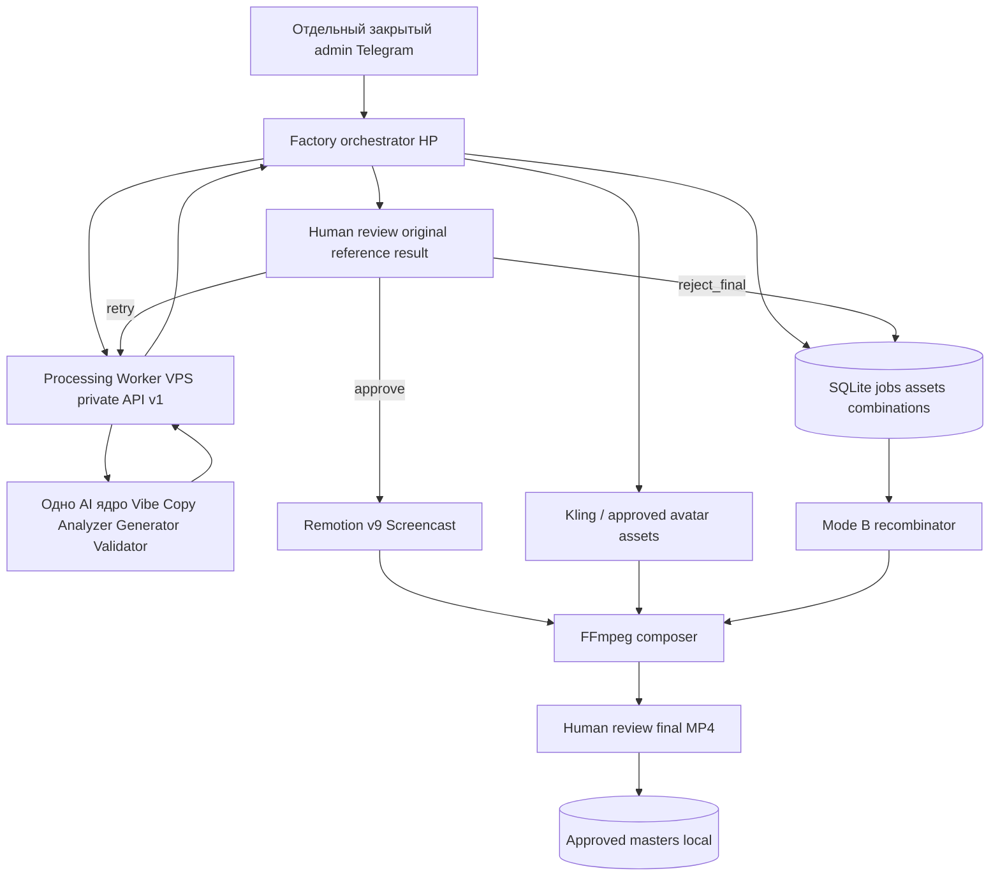

# Architecture decisions and data flow

## Physical topology (LOCKED)
- **VPS, repository Vibe Copy:** public Telegram bot process and **separate Processing Worker** process share Python AI core but have isolated factory job/cost state. Worker provides private REST API v1.
- **HP Windows, independent Content Factory repo with embedded `Remotion/` module:** Python `aiogram` admin bot + orchestrator, SQLite/WAL durable queue, local file store, Remotion v9 and FFmpeg executables. Future VPS migration must change deployment config only.
- Transport HP ↔ VPS = private Tailscale/WireGuard networking + dedicated Worker bearer token. Dev = localhost + fake AI provider. No requirement for Redis/Celery/Docker/cloud DB in MVP.

## Components
1. `factory/adapters/processing_worker.py`: HTTP adapter implementing submit/status/result, sha256 and version compatibility; no importing Python Vibe Copy internals into Factory.
2. `factory/queue/`: SQLite durable job runner, recovery, fair states. Each mode A slot and its attempts independent.
3. `factory/library/`: original/reference pairs, approved result immutable snapshots, avatar static/animated, screencast, hook, scenario, final.
4. `factory/review/`: Telegram callback state machine / approval, no extra AI aesthetic service.
5. `factory/remotion/`: Python wrapper invokes existing `./Remotion` CLI with independent case JSON/path and one render at a time, no Studio requirement. `Remotion` stays a subfolder of Factory, not a third repo.
6. `factory/composer/`: FFmpeg scenes, ASS/SRT captions, output validation.
7. `factory/recombination/`: select fresh combos in a single transaction; priority new avatar/screencast pairs; duplicates never allowed.
8. `factory/bot/`: standalone Telegram token; `ADMIN_USER_IDS` allowlist.

## Primary boundaries
- Worker `COMPLETED` means AI generation complete, NOT approved result. Only Factory owns review decision and approved library.
- Worker provider cost journal belongs on VPS. Factory mirrors reference/cost summary; don't double-charge when summing. Include `source_call_id` per event.
- One local heavy render; Remotion and FFmpeg are CPU/RAM intensive; external waiting is async with bounded concurrency.
- No shared sqlite over network, no direct SSH file copy and no networked Windows filepaths. Two independent VS Code windows; factory code receives Worker service via HTTP and never imports Vibe Copy modules.
- Factory already includes `./Remotion/` (owner-moved, completed v9). Preserve its visual UI and existing working cases; do not re-copy or reinitialize from the old ZIP. Backup by Git/ordinary copy before changing it.

## MVP delivery boundaries
Keep one working 30s montage layout before implementing four variations. Initially tags and templates supply captions/hooks, no LLM costs. For Mode A real Kling integration behind adapter; test mocks/pre-generated MP4 before real spend. Finish a mock end-to-end production test before going live.
